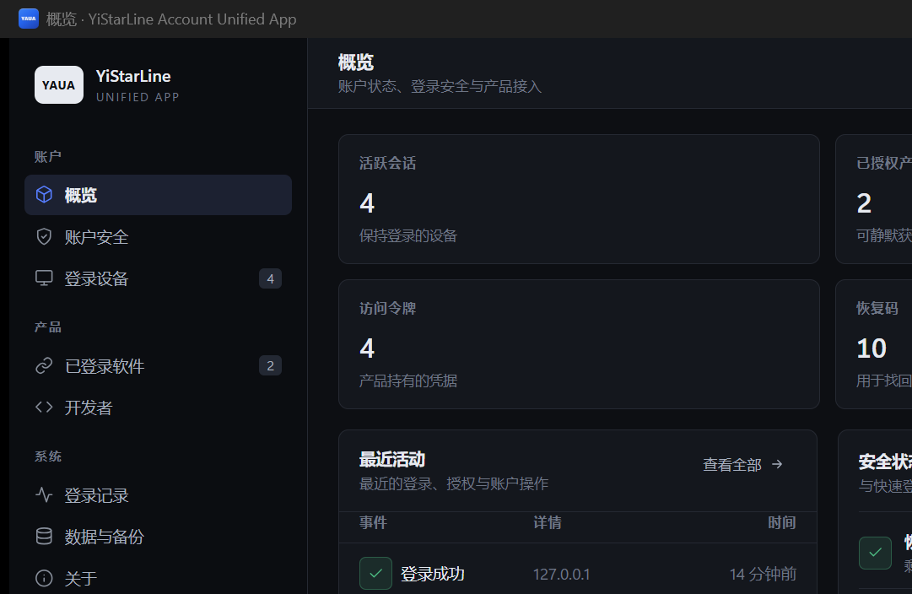
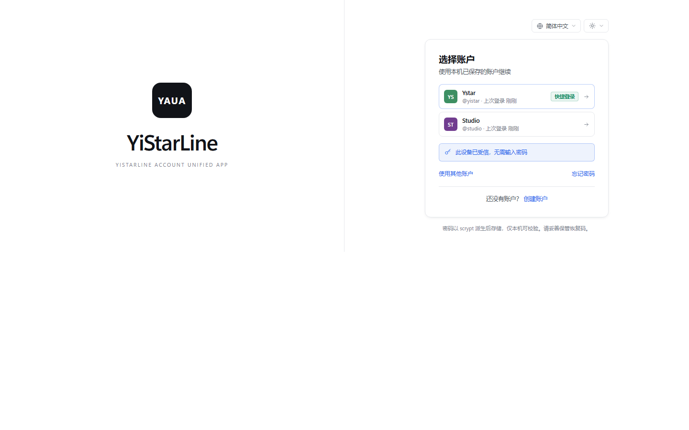
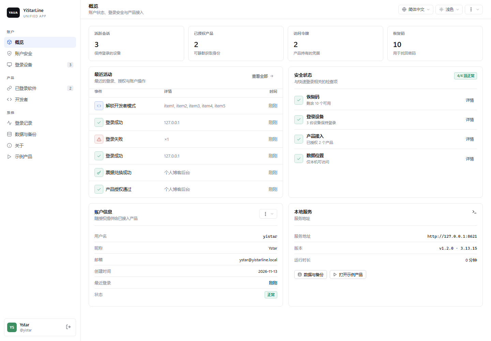
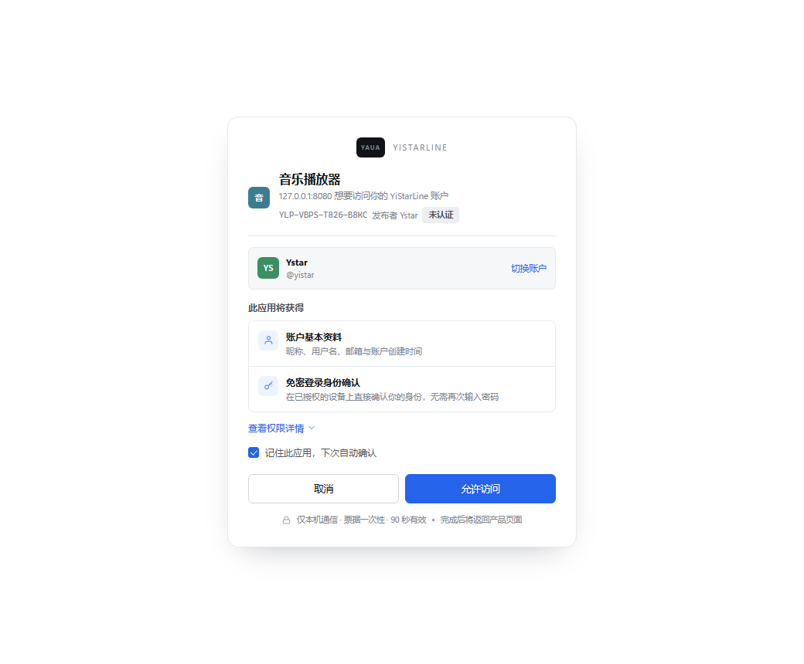

# YiStarLine Account Unified App

> 本机账户与单点登录中心 · 完全离线 · 为你的所有产品提供「一次登录，处处免密」

YiStarLine Account Unified App（简称 **YAUA**）是一个运行在本机的账户中心：注册、登录、会话、授权与审计都在本地完成，
再通过一个 OAuth 风格的 REST 协议把「用户是谁」交给你的其它产品 —— 网页、桌面程序、命令行工具都能接入，
不需要每个产品各写一套账户系统，也不需要任何云服务。

- **完全离线**：不联网、不上传，数据只写在本机用户目录
- **桌面客户端**：原生 Windows 窗口（内嵌 Chromium），支持托盘常驻、开机自启、深浅色自适应标题栏
- **浅色 / 深色 / 跟随时间**：默认纯白背景 + 黑色文字，可设为日间浅色、夜间深色
- **本机账户快捷登录**：登录页先列账户，受信设备一键进入，密码框默认隐藏
- **每次授权都确认**：类似 Microsoft / GitHub / Google 的授权确认页，可展开查看权限详情
- **已登录的软件**：一眼看到哪些产品正在使用你的账户，逐个退出
- **应用身份与 YiStarLine Protect**：每个应用都有可对外识别的应用码（`YLP-XXXX-XXXX-XXXX`）与发布者信息；
  认证按钮默认关闭，答对 4/5 道安全题后获得官方认证徽章与证书编号，授权页会展示
- **开发者模式**：普通用户看不到开发者入口，需在账户页二级菜单同意开发协议后解锁
- **完整账户能力**：注册、登录、改密、一次性恢复码、会话与设备管理、授权撤销、审计日志
- **产品接入**：一次性票据 + 访问令牌，附带浏览器 / Python / Node / C# SDK；
  应用用**应用码**首次授权即可在任意机器上使用，无需预先登记或分发密钥
- **多语言界面**：简体中文、English、日本語，切换后自动记住
- **零运行时依赖**：服务端只用 Python 标准库；桌面客户端用系统自带 .NET Framework 编译

---

## 界面预览









更多截图（深色模式、English / 日本語、密码步骤、示例产品、开发者协议、Android）见 `docs/screenshots/`。

---

## 快速开始

### 方式零：安装包（给最终用户）

双击 **`dist\YiStarLine Account Unified App Setup.exe`** 即可安装，**不需要管理员权限**：

- 解压后安装到 `%LOCALAPPDATA%\Programs\YiStarLineAccount`（当前用户目录，不碰 Program Files）
- 创建桌面与开始菜单快捷方式
- 登记卸载信息，可在「设置 → 应用」里正常卸载
- 可选写入开机自启（`HKCU\…\Run`，界面里随时能关）
- 不会删除已有的账户数据

也可以直接用 `dist\YiStarLine Account Unified App Setup.zip`（绿色包，解压后运行 `Setup.cmd`）。
重新打包：`installer\build-setup.cmd`（离线生成 zip + 自解压 exe）。

### 方式一：桌面客户端（推荐）

双击项目根目录下的 **`YiStarLine Account Unified App.exe`**。

首次启动会自动完成三件事：启动本地 SSO 服务 → 打开管理窗口 → 引导你创建第一个账户。
之后可以关闭窗口，程序会留在托盘继续为其它产品提供登录能力。

### 方式二：只跑服务

```bat
run\start-console.cmd                 :: 前台运行，便于观察日志
run\start-service.vbs                 :: 后台运行（开机自启用的就是这个）
run\open-ui.cmd                       :: 用浏览器打开管理界面
run\stop.cmd                          :: 停止服务
```

默认地址 `http://127.0.0.1:8600`；端口被占用时会自动顺延。首次运行会把数据写到
`%USERPROFILE%\YiStarLineAccount\data`（即 `C:\Users\<你的用户名>\YiStarLineAccount\data`）。

### 方式三：Android

见下文 [Android 端](#android-端)。

---

## 登录方式

1. 本机已有账户时，登录页先显示「选择账户」列表，而不是输入框；
2. 受信设备上的账户带「快捷登录」标记，点一下直接进入，无需密码；
3. 点其它账户只显示该账户的密码框（用户名已隐藏）；
4. 需要手动输入时，点「使用其他账户」展开完整的用户名 + 密码表单；
5. 密码登录时勾选「记住此设备」，下次即可一键登录；用恢复码重置密码会撤销全部受信设备。

---

## 目录结构

```
YiStarLineAccount/
├─ YiStarLine Account Unified App.exe     桌面客户端（双击即用）
├─ app/                                   本地 SSO 服务（Python 标准库）
│  ├─ server.py                           路由、静态资源、安全响应头、单实例锁
│  ├─ api.py                              全部 HTTP 接口
│  ├─ store.py                            SQLite 存储与迁移
│  ├─ sso.py                              票据 / 令牌 / 用户信息
│  ├─ security.py                         scrypt、校验、密钥
│  └─ config.py                           名称、版本、路径、端口
├─ web/                                   管理界面（原生 HTML/CSS/JS）
│  ├─ app.js  styles.css  index.html      SPA 与样式
│  ├─ i18n/  i18n.js  theme-init.js       多语言与主题
│  ├─ yl-sso.js                           浏览器 SDK
│  ├─ docs/integration.md                 产品接入指南
│  └─ demo/                               可运行的示例产品
├─ desktop/                               WinForms + WebView2 外壳与构建脚本
├─ android/                               Android 工程与离线打包脚本
├─ integration/                           Python / Node / C# 接入 SDK
├─ run/                                   启动、停止、开机自启、快捷方式
├─ tests/                                 自检、SDK 测试、截图脚本
└─ docs/screenshots/                      界面截图
```

---

## 让我自己的产品接入

### 1. 解锁开发者模式

开发者功能默认不可见。进入 **账户安全**（或概览的账户卡片）右上角 **⋮ → 开发者权限**，
逐条勾选 5 条开发协议后点「同意并解锁」，侧边栏才会出现 **开发者** 入口，接口文档与应用管理也才会显示。

### 2. 创建应用

管理界面 → **开发者** → 填写产品名称与回调地址 → 创建，得到：

- `app_id`：如 `ylc_AbCdEf123456`
- `app_secret`：如 `ylsec_…`（**只显示一次**，只放在后端）

### 3. 前端发起登录

```html
<script src="/yl-sso.js"></script>
<script>
  const { ticket } = await YLAccount.login({
    appId: 'ylc_你的应用ID',
    redirectUri: location.origin + '/sso/callback',
  });
  await fetch('/api/sso/exchange', {
    method: 'POST',
    headers: { 'Content-Type': 'application/json' },
    body: JSON.stringify({ ticket }),
  });
</script>
```

### 4. 后端兑换身份

```python
from yistarline_sso import YiStarLineSSO

sso = YiStarLineSSO(app_id="ylc_xxx", app_secret="ylsec_xxx")
info = sso.redeem(ticket)
user, token = info["user"], info["access_token"]
```

协议细节、错误码、安全清单与 FAQ 见 [web/docs/integration.md](web/docs/integration.md)。

---

## 数据与备份

| 文件 | 内容 |
| --- | --- |
| `data\accounts.db` | 账户、会话、应用、授权、票据、令牌、审计（SQLite WAL） |
| `data\secret.key` | 本机密钥，与用户密码一起派生哈希；丢失后只能重装 |
| `data\config.json` | 端口、语言、会话天数等配置 |
| `data\backups\` | 「立即备份」生成的一致性快照（VACUUM INTO） |

管理界面 → **数据与备份** 可一键备份、打开目录、设置开机自启、停止服务。

---

## 安全设计

| 项目 | 做法 |
| --- | --- |
| 密码存储 | scrypt（N=32768, r=8, p=1）+ 每用户随机盐 + 本机密钥，只存哈希 |
| 会话 / 令牌 | 数据库里只存 SHA-256 摘要，Cookie 为 HttpOnly + SameSite=Lax |
| 应用密钥 | 以 HMAC 形式存储，创建时只回显一次 |
| 票据 | `ylt_` 前缀、90 秒有效、一次性、绑定回调地址 |
| CSRF | 写操作要求 `X-YL-Client` 头 + Origin 校验 |
| 撞库防护 | 连续失败 5 次后逐步锁定（30 秒起，最长 15 分钟） |
| 本机绑定 | 校验 Host 头，抵御 DNS 重绑定 |
| 受信设备 | 独立设备令牌（仅存哈希），90 天有效，重置密码即撤销 |
| 审计 | 登录、改密、授权、撤销、开发者解锁等全部落库 |

---

## 开发者接口摘要

| 接口 | 用途 |
| --- | --- |
| `GET /sso/authorize` | 引导用户登录并展示授权确认页，回调 `ticket` |
| `POST /api/v1/ticket/redeem` | 用 `app_secret` 兑换 `access_token` 与用户资料 |
| `GET /api/v1/userinfo` | 用 Bearer 令牌读取用户信息 |
| `POST /api/v1/token/revoke` | 产品侧主动作废令牌 |
| `GET /api/v1/health` | 探测服务是否在线、版本与协议 |
| `GET /api/v1/apps/lookup?code=YLP-…` | 按应用码查询应用的公开身份：名称、发布者、认证状态与证书 |

兼容旧版接入：`client_id` / `client_secret` / `redirect` / `nonce` / `code` 等旧字段名仍然可用；
需要「已授权就静默放行」的旧行为时传 `prompt=auto`。

---

## 多语言与主题

- 语言：右上角切换 简体中文 / English / 日本語，选择写入 `localStorage`，刷新后保持
- 主题：浅色 / 深色 / 跟随时间；「跟随时间」在 07:00–19:00 用浅色，其余时间深色
- 桌面客户端标题栏会跟随页面主题自动切换

---

## 测试

```bat
python tests\selftest.py --base http://127.0.0.1:8600    :: 70 项端到端检查
python tests\sdk_check.py                                 :: Python SDK 检查
node tests\shots.mjs                                      :: 重新生成界面截图
node tests\sdk_check.mjs                                  :: Node SDK 检查（需服务运行）
```

---

## Android 端

同一套界面与账户逻辑，打包为独立应用（详见 [android/README.md](android/README.md)）：

| 项目 | 说明 |
| --- | --- |
| 安装包 | `android\out\YiStarLine Account Unified App.apk`（约 145 KB，已签名，minSdk 23 / target 36） |
| 构建 | `android\build-apk.cmd` —— javac → d8 → aapt2 → zipalign → apksigner，**全程离线**，无需 Gradle |
| 图标 | 自适应图标（蓝底 + 白色 YAUA），Android 5–7 回退到传统 PNG |
| 数据 | 应用私有存储，不上传、不联网；设置页可导出 / 恢复 JSON 备份 |
| 差异 | 没有本地 HTTP 服务与托盘；「停止服务 / 开机自启 / 打开目录」等桌面专属项自动隐藏 |
| 适配 | 移动端专属外壳：顶部标题栏 + 底部五个标签 + 账户抽屉；状态栏 / 手势条安全区、44px 触摸目标 |

功能对齐：注册、登录（账户选择 + 受信设备快捷登录）、改密、恢复码、会话与设备、已登录软件、
授权确认页、开发者协议解锁、审计日志、多语言与浅深色主题。

---

## 常见问题

**Q：忘记密码怎么办？**
A：用注册时生成的 10 个恢复码之一在「忘记密码」页重置；恢复码用完后需要重建账户。

**Q：换电脑怎么办？**
A：数据只在本机，把 `data` 目录整体拷到新机器同一位置即可（`secret.key` 必须一起拷）。

**Q：端口被占用？**
A：会自动顺延到下一个可用端口；也可以改 `data\config.json` 里的 `port`。

**Q：产品怎么做到零点击登录？**
A：授权请求里加 `prompt=none`，已授权时直接回调票据，不弹确认页。

---

本程序完全运行在本机，不包含任何遥测或联网上报。
